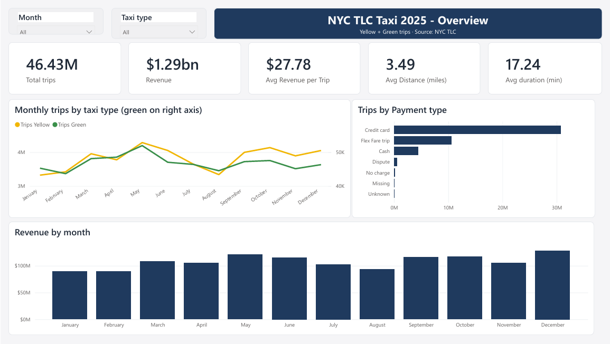
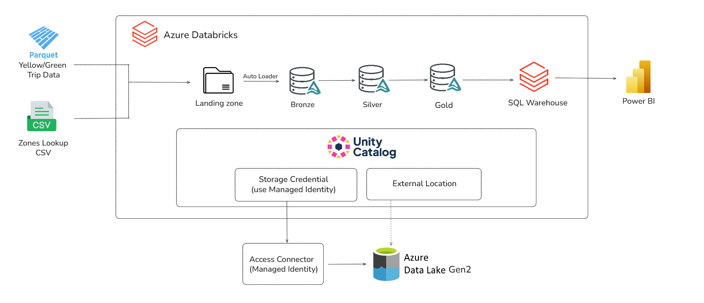
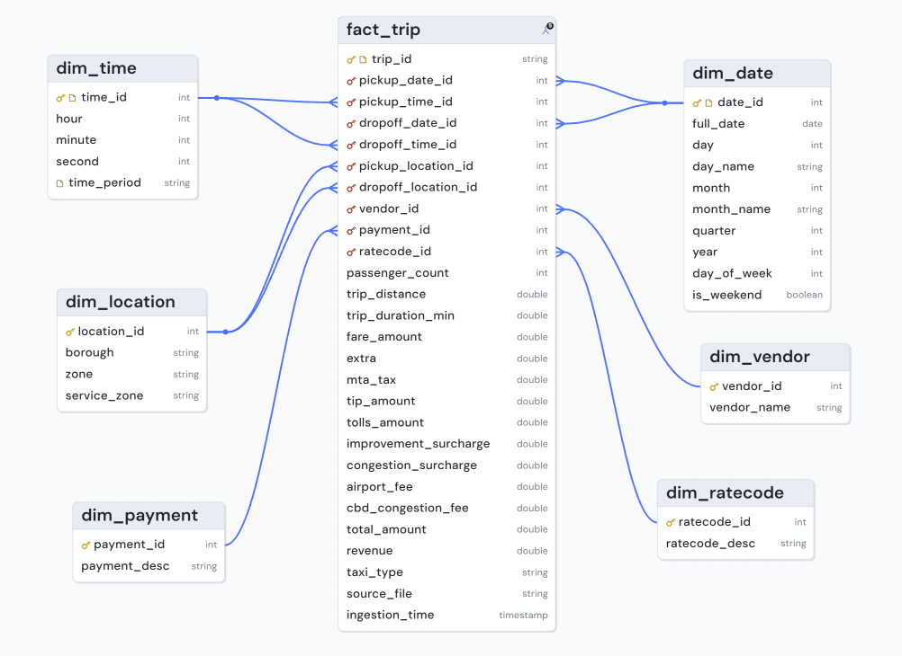
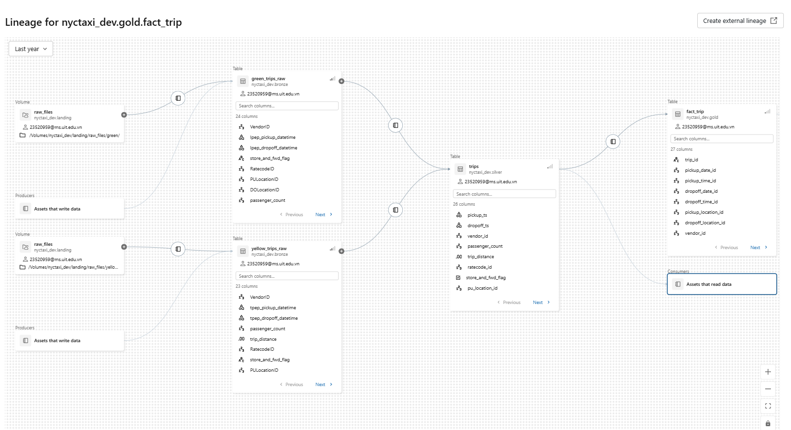
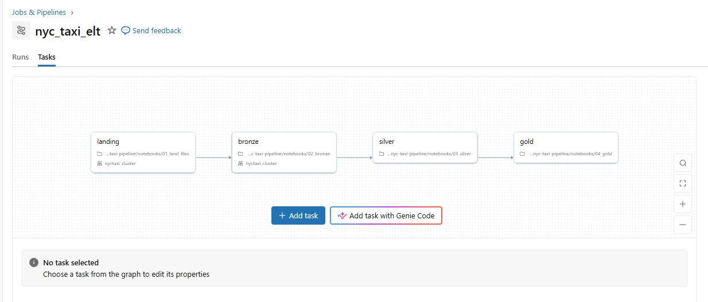

# NYC Taxi Lakehouse on Azure Databricks

A config-driven Medallion pipeline that ingests NYC TLC yellow and green taxi trips (2025) into Delta Lake on Azure Databricks, applies explicit data-quality rules with a quarantine table, and models the result as a star schema for Power BI.



## Architecture



| Layer | What it holds | How it is written |
| --- | --- | --- |
| Landing | Original TLC files in the Unity Catalog volume `landing.raw_files` | Download only missing files |
| Bronze | Delta tables with the source schema + `_source_file`, `_ingestion_time` | Auto Loader, exactly once per file |
| Silver | `trips` (yellow + green, one typed schema), `trips_quarantine`, `taxi_zones` | Delta `MERGE` / `replaceWhere` per taxi type × month |
| Gold | Star schema: `fact_trip` + 6 dimensions | Overwrite, with integrity checks |

**Tech stack:** Azure Databricks (Unity Catalog) · ADLS Gen2 · PySpark · Delta Lake · Auto Loader · Power BI

# Data model (Gold)
 

 
`fact_trip` has one row per valid trip. It holds keys and measures only; Power BI resolves the joins through relationships.

## Repository layout

```
config/            sources.yml, dimensions.yml
src/nyctaxi/       landing.py, bronze.py, silver.py, gold.py   (all logic)
notebooks/         01_land_files → 02_bronze → 03_silver → 04_gold   (thin shells)
docs/              setup, data quality, data model, design decisions, roadmap
```

## Quick start

1. Create the Azure resources, catalog and schemas: [docs/setup.md](docs/setup.md).
2. Add this repo as a Git folder in Databricks.
3. Run the notebooks in order with `catalog = nyctaxi_dev`, `start_month = 2025-01`, `end_month = 2025-12`, or run the `nyctaxi_monthly` job.

## Documentation

| Document | Content |
| --- | --- |
| [Setup and how to run](docs/setup.md) | Azure resources, catalog SQL, cluster, notebook parameters, job, Power BI |
| [Data exploration and quality](docs/data_quality.md) | Profiling findings and the Silver rules with reject counts |
| [Data dictionary](docs/data-dict.md) | TLC field definitions |

## Result



## Data source

[NYC Taxi & Limousine Commission trip record data](https://www.nyc.gov/site/tlc/about/tlc-trip-record-data.page).